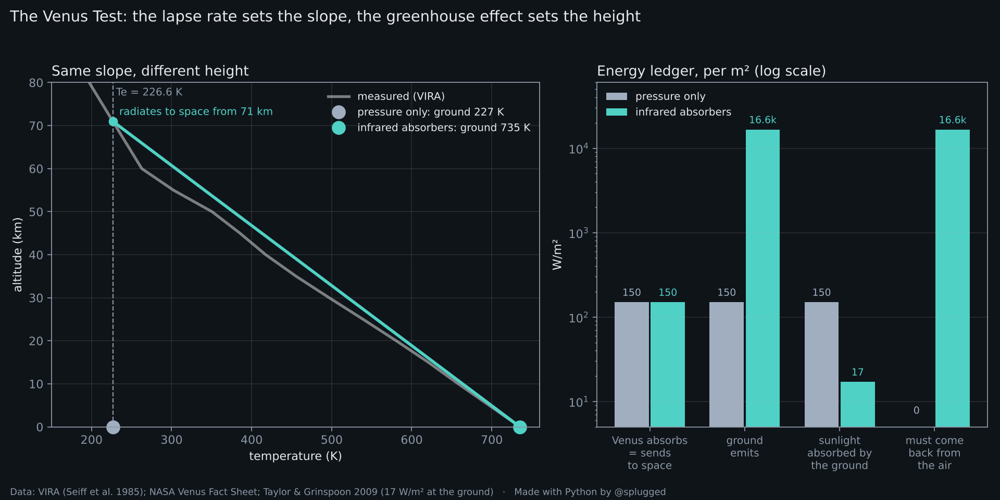

# The Venus Test

**Is Venus hot because of its 92 bar of pressure, or because of the greenhouse effect? Same planet, same sunlight, same pressure, same lapse rate: two runs, and an energy ledger that has to balance.**

**Interactive page:** https://davey811.github.io/venus-greenhouse/



## The claim being tested

A popular claim says the greenhouse effect isn't needed on Venus: the surface is at 735 K because of the pressure and the adiabatic lapse rate alone.

The lapse rate is real: Venus's air gets hotter towards the ground at about 7 K per km. The question is what sets the temperature at the ground, and that is decided by energy.

## The argument, step by step

1. **Venus is in energy balance.** It absorbs about 150 W/m² of sunlight, averaged over the planet, and sends the same back to space as infrared. Measurements by the Pioneer Venus Orbiter *"confirmed that the planet is in overall energy balance to within the accuracy of the measurements"* (Taylor & Grinspoon 2009, §2.4).
2. **Without infrared absorbers, the ground can't be warmer than 227 K.** If the air doesn't absorb infrared, it doesn't emit any either: the ground is the only thing that radiates, and all of its radiation escapes. So σT⁴, averaged over the ground, equals the 150 W/m² absorbed, and the ground sits at 227 K whatever the pressure, the winds, the convection or the lapse rate. A ground with hot and cold patches averages lower, not higher. Even if Venus reflected nothing (650 W/m² absorbed), the limit would be 327 K. *"An airless body with the same albedo and heliocentric distance as Venus would reach radiative equilibrium at a mean surface temperature of only about 230 K"* (§2.4).
3. **The real ground is at 735 K, and its infrared doesn't get out.** At 735 K the ground emits about 16,600 W/m² of infrared, 110 times what Venus absorbs and 25 times all the sunlight that reaches Venus. Only 150 W/m² leave Venus. The other ~16,400 W/m² of the ground's infrared is absorbed by the air. That is the greenhouse effect: *"the infrared radiation energy trapped by atmospheric gases and clouds"* (Raval & Ramanathan 1989). On Earth the same difference is about 156 W/m² (396 − 240); on Venus it is about 100 times larger. This step doesn't depend on how energy moves inside the atmosphere, only on how much leaves the ground and how much leaves Venus.
4. **The ground lives on what the air sends back.** *"Enough sunlight diffuses through the cloud layers on Venus to provide about 17 W per m2 of average surface insolation"* (§2.4). A ground that emits 16,600 W/m² and gets 17 W/m² from the Sun receives at least ~16,560 W/m² from the air above. Without the infrared trapped in step 3, the air would only have the ~130 W/m² of sunlight it absorbs itself to pass on, a hundred times too little.
5. **The lapse rate fills in the shape.** The energy *"must instead be raised by convection along an approximately adiabatic temperature-pressure profile to a level near the cloud tops where it can radiate to space"* (§2.4). On Venus that level is about 71 km, where the measured air is at 225 K; below it the temperature rises by about 7.1 K per km: 225.30 + 7.145 × 71.38 = 735.3 K. This step explains the profile, it doesn't prove anything: the 71 km and the slope are read from the measured profile, so 735 K comes out by construction. The proof is in steps 1 to 4.

```
T_ground ≈ T_e + lapse rate × emission height
```

The absorbers set the height. The lapse rate sets the slope.

## Two runs

| Per m², planet average | Pressure only | Pressure + infrared absorbers |
|---|---|---|
| Air in the infrared | doesn't absorb | absorbs: CO₂ above all, plus clouds and water vapour |
| Venus radiates to space from | the ground | about 71 km, where the air is at 225 K |
| Ground temperature | 227 K (−47 °C) | **735 K (462 °C)**, as measured |
| Sunlight absorbed = infrared sent to space | 150 W/m² | 150 W/m² |
| Ground emits, σT⁴ | 150 W/m² | 16,576 W/m² |
| Sunlight absorbed by the ground | 150 W/m² (the air is clear) | ≤ 17 W/m² (measured) |
| Must come back from the air | 0 | ≥ 16,559 W/m² (99.9%) |
| **Greenhouse effect:** ground's infrared that never reaches space | 0 | **16,426 W/m²** (Earth: about 156) |

The interactive page lets you switch off reflection in the first run (327 K, the ceiling) and move the emission height in the second. The second run matches Venus by construction, since its height and slope come from the measured profile: it shows the shape, the ledger is the proof.

## The published model: switch one absorber off

In the radiative-convective model of Venus by Bullock and Grinspoon (2001), as reported by Taylor and Grinspoon (2009, Table 2), removing one species at a time from the greenhouse calculation, with the planet's albedo unchanged (even when the clouds are removed), cools the surface by:

| Switched off | CO₂ | clouds | H₂O | OCS | CO | SO₂ | HCl |
|---|---|---|---|---|---|---|---|
| Surface cooling | 422.7 K | 142.8 K | 68.8 K | 12 K | 3.3 K | 2.5 K | 1.5 K |

One species at a time: the values are not additive. On the page you can switch off several at once. Table 2 doesn't give combinations, so the page shows only what is certain:

- the surface cools by **at least** the largest single effect, since taking more absorbers away only lowers the infrared opacity;
- it cools by **at most** about 509 K (735 − 227), which would leave the ground at T_e: with nothing absorbing infrared and the albedo fixed, that is where the first run sits;
- the plain sum of the single effects is not the answer. With everything switched off it comes to 653.6 K, which would leave the ground at 82 K, below T_e: impossible. Absorbers overlap in the spectrum and the response isn't linear, so the effects don't add up.

## The explicit equations

The same chain for Earth and Venus. It reproduces both measured surfaces, and it shows what the middle-of-the-mass rule leaves unexplained.

| | Earth | Venus |
|---|---|---|
| 1. Energy balance: σT_e⁴ = S (1 − A) / 4 | 1361 × 0.706 / 4 = 240.2 W/m², T_e = 255.12 K | 2601.3 × 0.23 / 4 = 149.6 W/m², T_e = 226.63 K |
| 2. Emission sphere: T_em = T_e (R / (R + z_e))^½ | 255.02 K (R = 6371.0 km) | 225.30 K (R = 6051.8 km) |
| 3. Emission height, set by the absorbers: τ(z_e) = 1, z_e = H ln τ₀; measured where T(z) = T_em | 5.097 km | 71.38 km |
| 4. Lapse rate, set by thermodynamics: dT/dz = −g / c_p, measured mean | 6.5 K/km | 7.145 K/km |
| 5. Ground: T_s = T_em + Γ z_e | 255.02 + 6.5 × 5.097 = **288.15 K** (measured 288.15 K) | 225.30 + 7.145 × 71.38 = **735.3 K** (measured 735.3 K) |
| Middle-of-the-mass rule: T_s = T_e + Γ z_half | 255.12 + 6.5 × 5.477 = 290.72 K, off by −2.57 K | 226.63 + 7.145 × 10.40 = 300.94 K, off by **+434.4 K** |
| 6. Without absorbers: τ₀ < 1, z_e = 0, T_s = T_e | 255.1 K | 226.6 K: the whole residual belongs to the absorbers |

First Law: if z_e rises, less power leaves than arrives, and dU/dt = P_in − P_out > 0 until the ground has warmed by Γ Δz_e.

Earth: U.S. Standard Atmosphere 1976 (288.15 K at the surface, 6.5 K/km in the troposphere, pressure from the hydrostatic equation, so half the mass lies above 5.48 km) and the NASA Earth Fact Sheet (1361 W/m², Bond albedo 0.294). Venus: VIRA, half the mass above 10.40 km. The emission heights are read from the measured profiles; computing them from the spectra is what the published model above does.

## Objections

**"Taylor and Grinspoon themselves say it's the mass of the atmosphere."**
They do: *"the high surface temperature on Venus, is largely a consequence of the large mass of the atmosphere, rather than any mysterious thermal process"* (§2.2). The same paper says how the mass works: *"Most of the energy deposited at depth cannot escape as long-wave radiation"* and has to be carried up to near the cloud tops before it can radiate to space (§2.4). A massive CO₂ atmosphere is a thick layer of infrared absorber, and that is what lifts the radiating level to 71 km. In the same paper, switching off CO₂'s absorption in the model cools the surface by 423 K (Table 2).

**"They also say Earth with 92 bar would be hot even without more greenhouse gas."**
The sentence is: *"If the Earth had such a high surface pressure, it too would be extremely hot, even without the increased proportion of greenhouse gases that is found on Venus"* (§2.2). With the same proportions, 92 times the air means 92 times the CO₂ above every square metre, and the higher pressure broadens the absorption lines: the absorber grows with the mass. What doesn't work is mass without absorbers, which is the first run: 227 K.

**"It's just the adiabatic lapse rate."**
The measured profile, in the paper's words, *"roughly follows the hydrostatic and adiabatic formulae"* (§2.2). The lapse rate says how much warmer the ground is than the level that radiates to space; it doesn't say where that level is. With no absorbers that level is the ground itself, and the ground sits at 227 K.

**"Compression heats the gas."**
Compressing a gas warms it while it is being compressed: the work done is pressure times the change in volume. Venus's atmosphere isn't being compressed. A pressure that doesn't change does no work, while the ground radiates away 16,600 joules per square metre every second.

**"Venus is closer to the Sun."**
Venus reflects about 76% of the sunlight it receives and absorbs less than Earth: the paper gives equilibrium temperatures *"of about 230 K for Venus and 250 K for Earth"* (§2.4). Even if Venus reflected nothing, a ground that radiates freely to space couldn't average more than 327 K.

**"The heat comes from the interior, from volcanoes."**
*"Interior heat release cannot, in any case, be the dominant influence in surface temperature, because of the constraints placed by the energy balance measurements"* (§2.4). What leaves Venus matches the sunlight it absorbs.

**"The first run is unrealistic: no gas at 92 bar is transparent in the infrared."**
Right, and that absorption is the greenhouse effect. The first run is the control: same mass, same sunlight, no infrared absorption. Whatever the real air adds on top of it, it adds by absorbing infrared.

**"The air could give the heat back by convection, not by radiation."**
It doesn't matter how the energy gets back to the ground. The ground sends out 16,600 W/m² as infrared and only 150 W/m² leave Venus, so the rest is absorbed by the air. Air that absorbs the ground's infrared is the greenhouse effect, whatever happens next. And on Venus convection carries energy up, not down: it is *"raised by convection"* towards the cloud tops (§2.4).

**"You tuned the second run to give 735 K."**
Yes: its height and slope are read from the measured profile, so it matches Venus by construction. It is there to show the shape, not to prove the greenhouse effect. The proof doesn't use it: it uses the ground's temperature, the energy that leaves Venus and the sunlight that reaches the ground, all measured.

**"At 1 bar Venus is at 15 °C, like the Earth."**
Not in the measurements. In VIRA the pressure is 1 bar at 50.5 km, where the air is at 346 K (73 °C); the air is at 15 °C at 56.8 km, where the pressure is 0.4 bar (log-linear interpolation in pressure, linear in temperature). The interactive page marks both levels with "Show the 1-bar level". Anchoring Earth's surface temperature at Venus's 1-bar level is a choice, not a measurement, and the anchor is the whole question.

**"Only 17 W/m² of sunlight reaches the ground. How can it be the greenhouse effect?"**
That's the strongest evidence for it. 17 W/m² of sunlight can't keep up a ground that emits 16,600 W/m². Almost all of the energy the ground receives arrives as infrared from the air above.

## Files

```
index.html          interactive page (self-contained)
venus_test.py       computes every number above from the data file and draws the figure
data/
  venus_vira.csv    Venus International Reference Atmosphere, 0–100 km
results/
  numbers.txt, venus_test.png
```

```
pip install numpy matplotlib
python3 venus_test.py
```

## Method and caveats

- **Sunlight absorbed:** 2601.3 × (1 − 0.77) / 4 = 149.6 W/m², planet average (NASA Venus Fact Sheet). T_e = 226.6 K. With nothing reflected: 2601.3 / 4 = 650.3 W/m², 327.3 K.
- **Average temperature:** for a fixed total emission, a ground at uneven temperatures has a lower mean temperature than a uniform one (the mean of T is at most the fourth root of the mean of T⁴), so 227 K and 327 K are upper limits.
- **Emissivity:** the ground is treated as black in the infrared. Rock is close to it; an emissivity of 0.9 would turn 227 K into 233 K.
- **Emission level and curvature:** the emission level is a sphere of radius R + h, slightly larger than the ground. To send out the same power it radiates at T_em = T_e × (R / (R + h))^½, with R = 6051.8 km (NASA). For Venus that is 225.3 K, reached by the measured profile at 71.38 km. Energy is conserved for any h; ignoring the curvature would shift the emission temperature by 1.3 K. Real emission comes from a range of heights and wavelengths; this is the level that matches the planet's total output.
- **Lapse rate:** (735.3 − 225.3) K / 71.38 km = 7.145 K/km, the mean of the measured profile from the ground to the emission level. The real profile is steeper near the ground and shallower above.
- **Greenhouse effect:** infrared emitted by the ground minus infrared sent to space. Earth: 396 W/m² from the surface minus 240 W/m² to space (equal to the sunlight absorbed, 1361 × (1 − 0.294) / 4).
- **"Must come back from the air"** is what the ground emits minus the sunlight it absorbs. Any heat the air's motions carry away from the ground only adds to it. On the page, the emission-height slider keeps today's 17 W/m² at the ground for every height.
- This is a test of energy bookkeeping, not a climate model. The full calculation, with real spectra and clouds, is the published model in the table above.

## Sources

- F. W. Taylor and D. H. Grinspoon (2009), *Climate evolution of Venus*, J. Geophys. Res. 114, E00B40, doi:[10.1029/2008JE003316](https://doi.org/10.1029/2008JE003316). Quotes from §2.2 and §2.4; Table 2 in §4.6.
- M. A. Bullock and D. H. Grinspoon (2001), *The recent evolution of climate on Venus*, Icarus 150, 19–37, doi:[10.1006/icar.2000.6570](https://doi.org/10.1006/icar.2000.6570). The model behind Table 2.
- Venus International Reference Atmosphere (VIRA): A. Seiff et al. (1985), *Models of the structure of the atmosphere of Venus from the surface to 100 kilometers altitude*, Adv. Space Res. 5. Values as tabulated in T. Balint (JPL), *Venus Conditions for the IPPW-6 Short Course Exercise* (2008): https://core.ac.uk/download/4719247.pdf
- NASA NSSDC Venus Fact Sheet: https://nssdc.gsfc.nasa.gov/planetary/factsheet/venusfact.html
- A. Raval and V. Ramanathan (1989), *Observational determination of the greenhouse effect*, Nature 342, doi:[10.1038/342758a0](https://doi.org/10.1038/342758a0). The definition quoted above is from the abstract.
- K. E. Trenberth and J. T. Fasullo (2012), *Tracking Earth's energy: from El Niño to global warming*, Surv. Geophys. 33, 413–426, doi:[10.1007/s10712-011-9150-2](https://doi.org/10.1007/s10712-011-9150-2). Earth's surface emission, about 396 W/m².
- NASA NSSDC Earth Fact Sheet: https://nssdc.gsfc.nasa.gov/planetary/factsheet/earthfact.html (solar irradiance 1361 W/m², Bond albedo 0.294).
- U.S. Standard Atmosphere 1976 (surface temperature and tropospheric lapse rate; pressures from the hydrostatic equation).

Code under the MIT licence. Made with Python by [@splugged](https://x.com/splugged).
